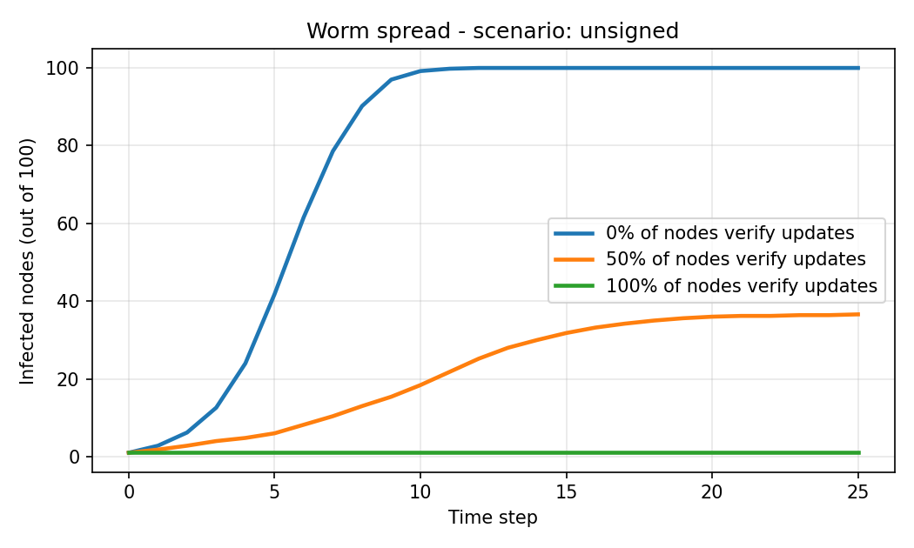
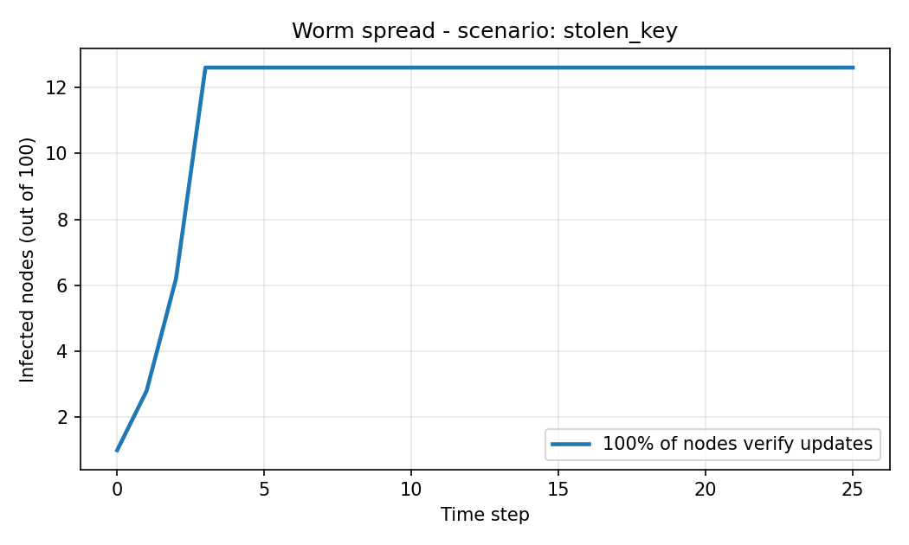

# WormGuard: Preventing Worm Propagation Using Digital Signatures and SHA-256 Integrity Verification

**Course:** Cryptography and Network Security  **Group:** 5  **AP Topic:** Worms

| Name | Roll No. |
|---|---|
| Aadhi Pranesh | 23L201 |
| Akif | 23L206 |
| Logiesh | 23L238 |
| Jeevan | 23L227 |
| Siddant | 23L263 |
| Sudharsana | 23L266 |

---

## Abstract
Network worms replicate across hosts without user action, and many spread by posing as legitimate
software or updates. This project implements WormGuard, a secure update system in which every update
is hashed with SHA-256 and digitally signed (RSA-2048-PSS or ECDSA P-256). A node installs an update
only if the signing key is trusted and not revoked, the signature is valid, the payload hash matches
the signed manifest, and the version is newer than the installed one. A simulation that runs the real
verification code on a 100-node network shows that a worm disguised as an update infects the whole
network when no node verifies updates, about a third to a half of it when half of the nodes verify,
and never leaves patient zero when all nodes verify. A stolen-key scenario shows that signatures alone
are not enough and that revocation is required.

## 1. Introduction
A worm is standalone, self-replicating malware that spreads over networks by exploiting vulnerabilities,
weak credentials, or trust in unauthenticated software. Famous cases include the Morris worm (1988), SQL
Slammer (2003), Stuxnet (2010) and WannaCry (2017). Stuxnet's drivers carried stolen digital certificates,
and WannaCry spread to unpatched machines. Both show that trust in code must be verified cryptographically,
and that keys must be managed carefully.

## 2. Problem statement
How can a network ensure that only genuine, unmodified software updates are installed, so that a worm
posing as an update cannot propagate?

## 3. Objectives
1. Authenticate the publisher of every update with digital signatures.
2. Detect any modification of an update using SHA-256.
3. Block replayed or downgraded updates.
4. Support key revocation after a compromise.
5. Measure how much verification reduces worm spread by simulation.

## 4. Background
**Hash function (SHA-256).** Maps any input to a 256-bit digest. It is preimage- and collision-resistant,
so changing a file changes its digest unpredictably. It provides integrity, not authenticity.

**Digital signature.** The publisher signs with a private key; anyone with the public key can verify.
It provides authenticity, integrity and non-repudiation. This project supports RSA-PSS (RFC 8017) and
ECDSA over P-256 (FIPS 186-5).

**HMAC.** A keyed hash giving integrity and authenticity with a shared secret. Used here to protect the
integrity-monitor baseline.

**Trust store and revocation.** A node lists the public keys it trusts and keys it no longer trusts. This
is a small stand-in for a PKI with certificate revocation.

## 5. System design

### 5.1 Threat model
The attacker can send arbitrary packages to nodes, modify packages in transit, replay old packages, and
create their own key pairs. The attacker cannot read the publisher's private key (except in the
stolen-key scenario) and cannot change a node's trust store.

### 5.2 Architecture
```
 PUBLISHER                                   NODE
 ---------                                   ----
 update file --SHA-256--> hash               trust store (public keys)
      |                     |                revocation list
      v                     v                installed versions
 manifest {name, version, sha256, size, key_id, algorithm}
      |                                            ^
      +--sign with PRIVATE key--> signature        |
      |                                            |
      +--> package.wgpkg = manifest + signature + payload ---> verify ---> install / reject
                                                                  |
                                                              audit.log
```

### 5.3 Package format
A `.wgpkg` is a ZIP with `manifest.json`, `signature.sig` and `payload.bin`. The signature covers the exact
bytes of the manifest, which contains the payload's SHA-256, so one signature binds the metadata and the file.
Package names are restricted to `[A-Za-z0-9._-]` to prevent path traversal, and size limits guard against
oversized archives.

### 5.4 Verification algorithm
1. Parse and validate the package structure -> `BAD_PACKAGE`
2. Key id in revocation list -> `REVOKED_KEY`
3. Key id not in trust store -> `UNTRUSTED_KEY`
4. Signature over manifest invalid -> `BAD_SIGNATURE`
5. SHA-256 or size of payload differs from manifest (constant-time compare) -> `HASH_MISMATCH`
6. Version not greater than installed version -> `ROLLBACK`
7. Otherwise -> `OK`, install and record the new version

Authenticity (steps 2-4) is checked before integrity (step 5), so unauthenticated data is never trusted.

### 5.5 Key identification
The key id is the SHA-256 of the DER-encoded public key, so it cannot be spoofed without a hash collision.
An attacker who copies a publisher's key id into their own package still fails at step 4.

## 6. Implementation
Language: Python 3. Cryptography: the `cryptography` library (no hand-written primitives).

| Module | Purpose |
|---|---|
| `crypto_utils.py` | hashing, HMAC, key generation/storage (optional password encryption), sign/verify |
| `package.py` | create and parse signed packages |
| `verifier.py` | trust store and the 6-check verification function |
| `node.py` | node directory, trust/revoke, install, state and JSON audit log |
| `simulation.py` | random network, worm spread, three attack scenarios, charts |
| `integrity.py` | HMAC-protected file-integrity baseline (bonus) |
| `cli.py`, `gui.py`, `demo.py` | command line, Tkinter GUI, scripted demonstration |
| `tests/test_wormguard.py` | 18 unit tests |

### 6.1 Simulation model
`N` nodes are connected in a ring plus random edges (average degree 4). Node 0 starts infected. Each step,
every infected node sends the worm package to each neighbour. An unprotected node is infected with probability
0.4. A protected node runs the real `verify_package()` and is only at risk if verification passes.
Scenarios:
- **unsigned:** attacker signs with their own key.
- **forged_id:** attacker claims the publisher's key id but signs with their own key.
- **stolen_key:** attacker has the publisher's private key, so the signature is valid until revocation.

## 7. Testing and results

### 7.1 Unit tests
18 tests pass, covering: SHA-256 known vector; RSA and ECDSA acceptance; tampered payload; tampered manifest
with matching hash (caught by signature); unknown signer; forged key id; revoked key; rollback; malformed
package; unsafe names; password-protected key round trip; node install and audit log; integrity monitor
(including a tampered baseline); and the simulation behaviours below.

### 7.2 Attack demonstration (`python -m wormguard demo`)
| # | Event | Result |
|---|---|---|
| 1 | Genuine update v1 | ACCEPTED (OK) |
| 2 | Worm signed with attacker's key | REJECTED (UNTRUSTED_KEY) |
| 3 | Worm claiming publisher's identity | REJECTED (BAD_SIGNATURE) |
| 4 | Payload swapped inside a signed package | REJECTED (HASH_MISMATCH) |
| 5 | Replay of installed v1 | REJECTED (ROLLBACK) |
| 6 | Genuine update v2 | ACCEPTED (OK) |
| 7 | Update signed with revoked key | REJECTED (REVOKED_KEY) |

### 7.3 Simulation (100 nodes, average of 5 random networks)
| Nodes verifying updates | Step 5 | Step 10 | Step 25 |
|---|---|---|---|
| 0% | 41.8 | 99.2 | 100 |
| 50% | 6.0 | 18.4 | 36.6 |
| 100% | 1.0 | 1.0 | 1.0 |



For one run with 100% adoption, 125 delivery attempts were blocked, all with `UNTRUSTED_KEY`; for the
forged-id scenario they were all `BAD_SIGNATURE`.

**Stolen key.** With all nodes verifying, the worm still infects all 100 nodes because its signature is
valid. When the key is revoked at step 4, the average final infection falls to about 12.6 nodes.



## 8. Security analysis and limitations
- **Private-key compromise** defeats signatures (Stuxnet-style). Mitigations: password-protected keys,
  hardware security modules, short-lived keys, and fast revocation (demonstrated above).
- **Trust store protection:** if malware can add its own key to a node's trust store, verification is bypassed.
  A real system would protect this store with the OS or hardware.
- **Revocation distribution** is manual here; real systems use CRLs or OCSP.
- **Scope:** WormGuard stops worms that arrive as fake updates. It does not stop worms exploiting memory-safety
  bugs in network services; patching, segmentation and IDS remain necessary (see presentation).
- **Simulation** is a simplified model (random graph, fixed infection probability). It illustrates the effect
  of verification and is not a prediction for real networks.

## 9. Conclusion and future work
Combining SHA-256 hashing, digital signatures, version checks and key revocation lets nodes reject worms
disguised as updates, and the simulation shows the infection dropping from the whole network to a single host
as adoption rises to 100%. Future work: certificate chains and timestamps, an automatic revocation feed,
update metadata with expiry (to stop freeze attacks), and a networked publisher/node demo over TLS.

## References
1. W. Stallings, *Cryptography and Network Security: Principles and Practice*, Pearson.
2. NIST FIPS 180-4, *Secure Hash Standard (SHS)*.
3. NIST FIPS 186-5, *Digital Signature Standard (DSS)*.
4. RFC 8017, *PKCS #1: RSA Cryptography Specifications Version 2.2*.
5. RFC 2104, *HMAC: Keyed-Hashing for Message Authentication*.
6. N. Weaver et al., "A Taxonomy of Computer Worms," ACM WORM, 2003.
7. D. Moore et al., "Inside the Slammer Worm," IEEE Security & Privacy, 2003.
8. NIST SP 800-83 Rev. 1, *Guide to Malware Incident Prevention and Handling for Desktops and Laptops*, 2013.
9. Python `cryptography` library documentation, https://cryptography.io
